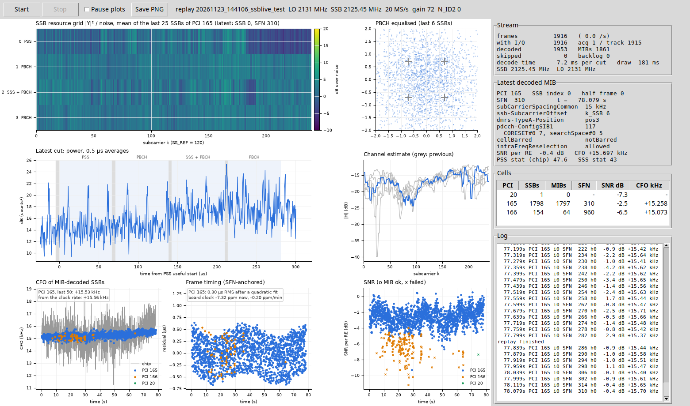

# esp32-5g-sniffer

**Read 5G NR synchronisation blocks with a €5 Wi-Fi chip.** An ESP32-C5 development board, with its own PCB antenna, receives the SS/PBCH blocks (SSBs) of 5G cells. This project decodes them into:

- the cell identity (PCI), the SSB index (beam), the frame number (SFN) and the full MIB, explained field by field in the live view (where the cell's SIB1 control channel is, which cells are sectors of one site);
- the frequency offset, with the board's crystal error as a by-product;
- frame timing to about 0.1 µs on the chip's clock;
- a channel estimate for every SSB.

It is receive-only, and it decodes only the broadcast signals every phone reads before it connects.



*The live view, with the board on the n1 cell PCI 165, indoors. The panels show:*
- *the SSB resource grid and the PBCH constellation;*
- *the raw cut and the channel estimate;*
- *CFO, SFN-anchored timing and SNR over time;*
- *the decoded MIB.*

## What it does

- **On-chip SSB detection** (firmware command `SSBDET`, our fork of [ESPsoup](https://github.com/pit711/espsoup-firmware)):
  - the ESP32-C5 finds the SSBs of a cell and tracks them on the 20 ms grid;
  - it sends only the I/Q around each SSB, 25 SSBs per second (every second SSB of a 20 ms cell) over USB full speed, where a continuous stream would need 8 times the bandwidth.
  - version 3 also searches for the cell itself (all N_ID2, ±30 kHz), puts the PCI from the SSS in every frame, sends 5 MS/s cuts and stamps them in 62.5 ns steps.
- **A complete NR SSB receiver in NumPy** (`capture/nr_ssb.py`):
  - the chain: PSS → SSS → PBCH DM-RS → channel estimate → PBCH → CRC-aided polar list decoding → BCH → MIB;
  - 15 and 30 kHz SSBs, L_max 4 and 8, a fast search over the whole GSCN raster, RSRP (uncalibrated);
  - checked bit for bit against MATLAB's 5G Toolbox;
  - about 7–15 ms per SSB on a laptop.
- **A live view** (`capture/ssb_live.py`):
  - plays a session from the board or a recording;
  - finds the cell by itself (`--ssb auto`), recovers from board resets, can record;
  - shows several cells at once, each of which can be shown or hidden;
  - selects the channel in the window: scan a list of LOs, double-click a found cell to track it, or switch the chip to another sector of the same site.
- **A reference detector in MATLAB** (`matlab/ssb_detect.m`, 5G Toolbox): it searches the whole GSCN raster, both subcarrier spacings (15/30 kHz) and L_max 4/8. It also sums SSS statistics over bursts, to find weak cells.
- **A cell scanner** (`capture/cell_scan.py`, and in the live view): every NR cell on the raster around one or more LOs, or over the C5's whole 2.13–2.73 and 4.79–5.99 GHz, as a table with PCI, SNR, RSRP, CFO and MIB.
- **A headless monitor** (`capture/ssb_monitor.py`): every decoded SSB as JSON, CSV or UDP, with alerts for new PCIs, MIB changes, SFN or timing jumps and frequency outliers.
- **Capture and survey tools:**
  - burst captures and band surveys with stitched spectra;
  - SigMF export with one annotation per SSB;
  - a session format shared by Python and MATLAB;
  - a fake board for tests.

## Results (measured with one board, indoors, November 2026)

| | |
|---|---|
| NR cells found | band **n1** (2.1 GHz): PCI 165, 166 (two sectors of one site), 20 (another site); band **n7** (2.6 GHz): PCI 317 |
| MIB decoding | every SSB caught in first light: 18/18 (20 MS/s), 13/13 (40 MS/s); live: 1780 of 1781 SSBs of PCI 165 in 78 s |
| SNR | MIBs decode down to about −6 dB per resource element; the board antenna gave −5 to +11 dB |
| Frame timing | 51–118 ns RMS against the cell's SFN grid with firmware version 3 (version 2: 0.30 µs, its 1 µs timestamp rounding) |
| Frequency offset | equals the board's crystal error measured from the timing, to 30–130 Hz |
| Throughput | 25 SSB cuts per second (every second SSB) over USB full speed, no frame lost; 2 tracking misses in 3000 |
| On-chip PCI | equal to the host's decoding in 2930 of 2930 SSBs |

Details, figures and what went wrong on the way: [docs/results.md](docs/results.md).

## Quick start

Without hardware, replay the included sample:

```bash
git clone --recurse-submodules <this repo> && cd esp32-5g-sniffer
python3 -m venv .venv_local && .venv_local/bin/pip install -e .   # or: pip install -r requirements.txt
.venv_local/bin/python -m capture.ssb_live --replay samples/ssbdet_pci165_150cuts
.venv_local/bin/python -m capture.ssb_monitor --replay samples/ssbdet_pci165_150cuts --speed 0 --stdout
.venv_local/bin/python -m unittest discover -s tests -t .        # GUI tests need xvfb-run
```

With an ESP32-C5 board:

```bash
firmware/fw.sh build && firmware/fw.sh flash /dev/ttyACM0       # needs the pinned ESP-IDF, see firmware/README.md
.venv_local/bin/python -m capture.cell_scan --port /dev/ttyACM0 --freq 2131 2670             # which cells are there? (--freq 2g 5g: everything the C5 tunes)
.venv_local/bin/python -m capture.ssb_live --port /dev/ttyACM0 --freq 2131 --ssb 2125.45
```

`--freq` is the LO in whole MHz; the C5 tunes 2130–2730 and 4790–5990 MHz. `--ssb` is the SSB centre frequency (SS_REF), from the cell scanner, a phone app that shows the NR-ARFCN of your serving cell, or `--ssb auto`. Without `--nid2`/`--cfo` the live view finds the strongest cell at that frequency first.

## Documentation

| Page | Contents |
|---|---|
| [docs/hardware.md](docs/hardware.md) | the ESP32-C5 as a receiver: tuning ranges, capture modes, crystal behaviour, USB quirks, which 5G bands it can reach |
| [docs/firmware.md](docs/firmware.md) | building and flashing; SSBDET from the host side (protocol in [the fork's docs/ssbdet.md](firmware/espsoup-firmware/docs/ssbdet.md)) |
| [docs/host_tools.md](docs/host_tools.md) | all commands: captures, `ssb-stream`, the cell scanner, the live view, the monitor, SigMF export, band surveys, the session format, the MATLAB tools, tests |
| [docs/receiver.md](docs/receiver.md) | the NR receive chain and its pitfalls (the TS 38.211 symbol phase, the 7 kHz CFO ambiguity, timing) and how it is validated |
| [docs/results.md](docs/results.md) | measurements: first light in n1, on-chip detection, live runs, the band survey with NR in n7, the crystal |
| [docs/roadmap.md](docs/roadmap.md) | feature ideas and what is done |

## Requirements

- An ESP32-C5 board with native USB. Other ESP32 chips run ESP-SDR too, but SSBDET is C5-only. The C5 cannot reach n78 (3.3–3.8 GHz).
- Python 3.10+ with NumPy, matplotlib and pyserial (`requirements.txt`). Tk is needed for the live view, `xvfb-run` for headless GUI tests, a C compiler for the firmware-DSP test.
- For the firmware: ESP-IDF at the commit ESPsoup pins (see [firmware/README.md](firmware/README.md)).
- Optional: MATLAB R2025b with the 5G Toolbox for the reference detector, the simulation and the test-vector export.

## Legal and safety

- **Receive only.** Nothing here transmits.
- **What is decoded:** only the broadcast synchronisation and MIB, as any phone does. Check what your local law allows before recording radio signals.
- **Test signals** (`matlab/make_n310_ssb_waveform.m`) are for a cabled setup with attenuators. Never transmit them over the air in a licensed band.

## Credits and licence

- Built on [ESP-SDR](https://github.com/ESPARGOS/esp-sdr) by the ESPARGOS team (University of Stuttgart) and its ESP32-C5 fork [ESPsoup](https://github.com/pit711/espsoup-firmware) by pit711.
- The NR procedures follow 3GPP TS 38.211, 38.212 and 38.213. MATLAB's 5G Toolbox served as the reference implementation for the tests.
- Licence: **GPL-3.0-or-later** for everything in this repository (see `LICENSE`), like ESP-SDR and ESPsoup. ESP32 is a trademark of Espressif Systems; this project is not affiliated with Espressif or ESPARGOS.
