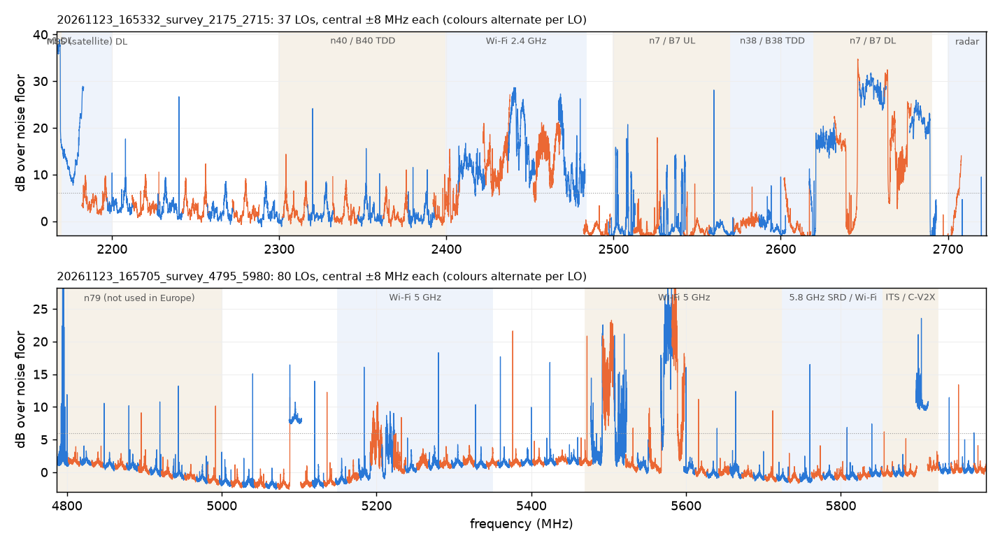

# Results

The setup for everything on this page:
- **Hardware and place:** one ESP32-C5 development board (rev 1.0) with its PCB antenna, indoors at an urban location in Austria, November 2026. Receive only.
- **Receivers:** the MATLAB reference detector and the NumPy receiver, both with the symbol-phase fix ([receiver.md](receiver.md)).
- **Sources:** measurements unless marked *simulation*.

## First light in band n1 (23 Nov 2026)

**Captures:** LO 2131 MHz, the lowest the C5 tunes exactly; full bursts at 20 MS/s (1.64 ms, 300 bursts) and 40 MS/s (0.82 ms, 600 bursts); auto gain.

**What was found:**
- **NR cell PCI 165, SSB at 2125.45 MHz** (GSCN 5314), 5.55 MHz below the LO, at the top of one operator's n1 block.
  - Only SSB index 0 seen.
  - MIB: subCarrierSpacingCommon 15 kHz, k_SSB 6, DMRS type A position 3, pdcch-ConfigSIB1 117 (CORESET#0 7, searchSpace#0 5), not barred, intra-frequency reselection allowed.
- **PCI 166** at the same frequency: the same N_ID1 (55), the next N_ID2, the same SFNs and timing, so a co-sited sector.

| Capture | SSBs of PCI 165 | MIB decoded | SSBs of PCI 166 | MIB decoded | SNR per RE (median) |
|---|---|---|---|---|---|
| 20 MS/s, 300 bursts | 18 | 18 | – | – | −1.2 dB |
| 40 MS/s, 600 bursts | 8 | 8 | 5 | 5 | −1.4 / −4.9 dB |

**Checks:**
- **Hit rate:** 18 SSBs in 300 bursts (6 %) fits one SSB per 20 ms; 6.7 % is expected.
- **SFN against time:** the decoded SFNs advance with the burst timestamps (+12 frames over 0.12 s, +286 over 2.89 s).
- **Frame timing** (frame start minus SFN × 10 ms, board clock drift removed): 0.72 µs RMS (20 MS/s, 18 MIBs), 0.44 µs (40 MS/s, 8 MIBs), 0.30 µs (PCI 166, 5 MIBs).
- **Re-encoding:** the decoded MIB matches 82 % of the received coded bits; with the SFN off by one, 45 % (chance).
- **Another signal:** an NR PSS (N_ID2 2) at 2145.75 MHz, in another operator's block, on a stable 5 ms grid, but never an SSS. Open.

## On-chip SSB detection (SSBDET, 23 Nov 2026)

**30 s on PCI 165** (20 MS/s, 8 bit):
- **Throughput:** 737 SSB cuts (24.5 per second): 3 acquisition bursts, then 743 tracking captures with 7 misses; no frame lost.
- **On the chip, per burst:** decimation 4.9 ms, PSS search 7.9 ms (average), sending a cut 17.8 ms.
- **MIBs decoded on the host:**
  - MATLAB: 628 of PCI 165 and 96 of PCI 166.
  - The live view's decoder (which also tries the other N_ID2 on each cut): 655 and 152.
  - With random bursts this would take about 35 times longer.
- **Frame timing from the decoded SFNs:** 0.30 µs RMS (max 0.68 µs) over 29.6 s. This is the 1 µs rounding of the firmware's timestamps. Its drift (−7.13 ppm) equals the chip's own estimate.
- **PCI 20** (N_ID2 2, another site with its own SFN numbering) decoded 3 times in a first run.
- **The firmware DSP on a PC:** found 18/18 and 8/8 of the reference detector's SSBs within 0.17 µs, with no false detection.

## Firmware version 3 on the board (24 Nov 2026)

**Setup:** PCI 165 at 2125.45 MHz (LO 2131 MHz, gain 76), board at another place than on 23 Nov. Every cut decoded on the PC.

| | Version 3.1 | Version 2 (23 Nov) |
|---|---|---|
| SSBs, 120 s, 5 MS/s cuts | 2999 (25 per second), 2 tracking misses in 3000 | 737 in 30 s, 7 misses in 743 |
| MIBs decoded | 3357 (PCI 165 and 166) | 724 |
| PCI from the chip's SSS | 2930 equal to the PC's, 0 different, 51 below its threshold | – |
| frame timing (SFN-anchored, quadratic clock fit) | 51–118 ns RMS | 0.30 µs RMS |
| cell search on the chip, from 0 kHz, ±30 kHz, all N_ID2 | first SSB after 4, 4, 8, 26 s | – (host scan) |

**Found and fixed during the test:**
- **The first cell search was too slow on the chip:** 4.9 s per burst, no SSB in 35 s. A frequency-domain search (version 3.1) needs 0.78 s per burst.
- **0.4 % of the captures were 4.7 µs late** behind their timestamps: an interrupt between the timer read and the capture start. Since interrupts are off there, there were none in 3357 MIBs.

**Still open:**
- Only every second SSB is captured: the cycle per SSB is just over 20 ms.
- The tracking misses rise at weaker signal: in one run, 31 misses in 315 tracking captures with a median statistic of 28. It is not clear why the same statistic gave 2 misses in another run.

**The live view and the headless monitor** ran on the board with version 3:
- the live view with `--ssb auto` decoded 1403 MIBs from 1405 SSBs, at 0.07 µs RMS;
- the monitor, with raw cuts, decoded 1142 MIBs with no false alert.

**The cell scanner** (NumPy, live), at LO 2131 and 2670 MHz with 100 bursts each:
- PCI 165 and 166 in n1;
- PCI 317 in n7.

Every SSB it found decoded its MIB. Both cells give the board's crystal as −5.2 ppm.

## Live view (23 Nov 2026, 78 s)

- **Cuts:** 1916 (25 per second, no CRC error, none skipped).
- **Cells:** PCI 165 decoded 1780 MIBs from 1781 SSBs; PCI 166 64 of 154; PCI 20 one SSB.
- **The board's crystal warmed up:** −7.2 → −7.3 ppm at −0.20 ppm/min, and the CFO rose from 15.1 to 15.6 kHz. After a quadratic clock fit the frame timing is 0.30 µs RMS.
- **The CFO implied by the measured clock rate (+15.56 kHz) matched the measured CFO (+15.53 kHz).**

## Band survey: 2.18–2.72 and 4.8–6.0 GHz (23 Nov 2026)

**Captures:** 15 MHz steps, 60 bursts per LO (2175–2715 MHz) and 30 per LO (4795–5980 MHz), 20 MS/s, gain 72.

**The SSB search** (MATLAB detector, all GSCN positions, CFO window centred on the board's crystal error at the time, +2.9 ppm):

| Range | SSB subcarrier spacing | Found |
|---|---|---|
| 2175–2715 MHz | 15 kHz, L_max 4 | **PCI 317 at 2667.75 MHz (band n7)**, SSB index 3, 5 of 5 MIBs, SNR +11 dB |
| 2175–2715 MHz | 30 kHz, L_max 8 (TDD n38/n40/n41) | none |
| 4795–5980 MHz | 30 kHz, L_max 8 (n79, n46) | none |

**Spectrum:**
- Three 20 MHz carriers in the band 7 downlink (2620–2690 MHz), most likely LTE.
- Wi-Fi at 2.4 and 5 GHz.
- Nothing in n40 (2300–2400 MHz) or n38 (2570–2620 MHz).
- Two LO windows near 5.1 and 5.9 GHz are raised flat by 8–10 dB, most likely a receiver artefact; above 5.75 GHz the normal tuning path is weak.

With on-chip detection, PCI 317 gave 306 SSBs in 15 s.

**A repeat on 24 Nov at 05:40**, with the board at another place:
- **Same result:** PCI 317 in n7 (3 MIBs, +4.3 dB, 6 dB weaker), nothing at 30 kHz, nothing at 4.8–6 GHz.
- **The band 7 carriers were not visible in the spectrum**, at 05:40 or at 07:05: about 0 dB above the floor, against 14–24 dB on 23 Nov.
  - Their coming back for the day would have shown at 07:05, so a night switch-off is less likely.
  - PCI 317 still decodes at the new place, at +4.5 dB. Carriers from the same site would show about 17 dB above the floor.
  - So they most likely come from another site, shadowed at the new place (*estimate*). A capture at the old place would tell.
- **The n1 band's top edge** (2160–2170 MHz) was about 25 dB weaker.

**Cross-check without MATLAB:** the NumPy raster search (`capture/cell_scan.py`) on the 23 Nov survey bursts at LO 2655–2685 MHz also finds PCI 317 at GSCN 6669: 5 of 5 MIBs, CFO −8.11 kHz (MATLAB −8.109 kHz), SSB index 3. Its MIB: k_SSB 6, pdcch-ConfigSIB1 16, not barred.

## Scan of the whole tuning range in the live view (24 Nov 2026, 10:58)

The live view's Channel tab, `2g 5g`, on a virtual display with the board:
- **Coverage:** 152 LOs from 2130 to 2730 and 4790 to 5990 MHz, in 12 MHz steps (SSB centres 2124–2736 and 4784–5996 MHz without gaps).
- **Settings:** 2 looks per SSB, auto gain (index 68–80), 2 decoder processes.
- **Time: 14.1 min** (845 s), of which the 2 GHz part took 6.0 min.
- **Bursts:** 47 per LO in the median (41–65), 7164 in all. The old survey took 60 untimed bursts per LO and still left 3–15 % of the SSB period uncovered at some LOs.

| Found | SSB | SCS | MIBs / SSBs | SNR | CFO |
|---|---|---|---|---|---|
| PCI 165 (n1) | 2125.45 MHz | 15 kHz | 2 / 2 | −2.1 dB | +12.56 kHz |
| PCI 317 (n7) | 2667.75 MHz | 15 kHz | 2 / 2 | +2.1 dB | +15.94 kHz |

- **Nothing else:** no 30 kHz SSBs in the TDD bands (n40, n41/n38), and nothing at 4.8–6 GHz, as in the surveys of 23 and 24 Nov. As far as we know, no operator runs NR in 5 GHz in Austria (n46 is unlicensed, n79 is used in Asia).
- **Not found: PCI 166** (−4.4 dB), the sector next to PCI 165, which 100 untimed bursts had found at 07:04. Two looks give every SSB about two chances.
- **The crystal:** −5.91 ppm from PCI 165 at the first LO, −5.98 ppm from PCI 317. From the first decoded cell on, every LO searched ±2 ppm (3 CFO steps) instead of ±30 kHz (13 steps).

Log: `results/sweep_2g5g_20261124.jsonl` (one line per LO), window: `results/ssb_live_sweep_2g5g.png`.

## SIB1 of PCI 317, decoded offline (23 Nov recording, decoded 24 Nov 2026)

`matlab/sib1_offline.m` on the 60 bursts of the 23 Nov survey at LO 2670 MHz:
- **Frame clock:** 5 bursts with PCI 317's MIB gave its frame clock on the board's clock: +3.0 ppm, residual 0.22 µs RMS.
- **Where SIB1's control channel is**, from the MIB (pdcch-ConfigSIB1 16): CORESET#0 of 24 RB × 2 symbols at 2665.50–2669.82 MHz, Type0-PDCCH in slots 3 and 4 of even frames.
- **SIB1 decoded:** 5 such slots lay whole in a burst. In 2 of them (slot 3 of SFN 240 and 336) the PDCCH carried a DCI 1_0 with the SI-RNTI:
  - aggregation level 4, RBs 0–19, symbols 3–11 (TDRA row 2), MCS 4, RV 0;
  - its PDSCH decoded with the CRC passing: a 111-byte SIB1, identical in both.
- **When the cell sends it:** both SFNs are multiples of 16, the start of a 160 ms SIB1 period. The other 3 slots held no SIB1, and on 24 Nov no slot 3 of such a frame was captured. So the cell most likely sends SIB1 once per 160 ms without repetitions (*estimate* from 11 slots).
- **The network:** bit 42 of the message holds MCC 232 (Austria) followed by MNC 05.
  - This is read from the bit pattern, not yet from a full ASN.1 decode.
  - As far as we know, 232-05 is Hutchison Drei Austria.
- **SNR:** the empty symbols of that slot (2 and 12) are about 29 dB below the occupied ones.

PCI 165 (n1, LO 2131): none of the 9 suitable slots in the 23 Nov n1 recording was in a frame with SFN divisible by 16, and none carried SIB1. Its CORESET#0 (2120.68–2129.32 MHz) also reaches 0.3 MHz past the 20 MS/s band at LO 2131 (the C5 tunes no lower). A capture timed to that slot would settle it.

## The board's crystal

The frequency offset of a cell, and the drift of its SFN-anchored timing, measure the board's crystal against the base station. The two agree to 30–130 Hz, and two base stations agreed on the board's clock within 0.2 ppm.

The crystal itself:
- **First day:** −5.1 to −7.3 ppm, moving with temperature (−0.2 ppm/min while warming up).
- **First day, evening:** +2.9 ppm, after two spontaneous resets.
- **Second day:** −3.1 ppm right after plugging in, −6.5 ppm after 8 minutes of capturing.

Large and sudden, so the CFO must be found again at every start. Firmware version 3 answers `BOOT?` with the reset reason, which will show whether the resets are brownouts.

## Simulation (not measured)

AWGN with a model of the C5 receiver (CFO, DC, IQ imbalance, 8/10-bit quantisation), `matlab/sim_ssb_detection.m`:
- **PCI correct per SSB:** 50 % at about −7 dB SNR per resource element, 98 % at −5 dB.
- **MIB per burst with soft combining:** 86–94 % at −7 dB.
- **CFO error:** 60–180 Hz RMS.
- **Noise only:** no false detection in 200 bursts.
