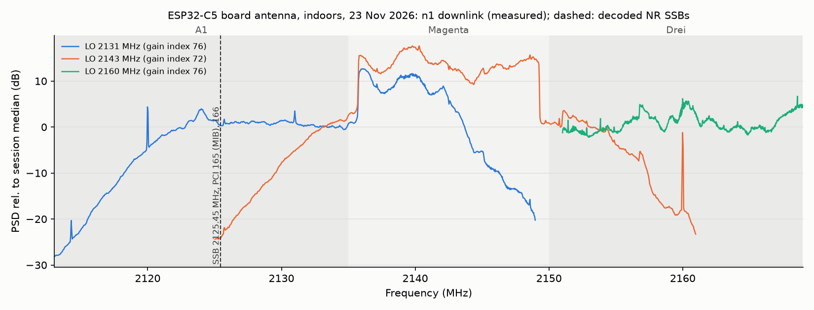

# Results

The setup for everything on this page:
- **Hardware and place:** one ESP32-C5 development board (rev 1.0) with its PCB antenna, indoors at an urban location in Austria, November 2026. Receive only.
- **Receivers:** the MATLAB reference detector and the NumPy receiver, both with the symbol-phase fix ([receiver.md](receiver.md)).
- **Sources:** measurements unless marked *simulation*.

## First light in band n1 (23 Nov 2026)

**Captures:** LO 2131 MHz, the lowest the C5 tunes exactly; full bursts at 20 MS/s (1.64 ms, 300 bursts) and 40 MS/s (0.82 ms, 600 bursts); auto gain.

**What was found:**
- **NR cell PCI 165, SSB at 2125.45 MHz** (GSCN 5314), 5.55 MHz below the LO, at the top of one operator's n1 block.
  - Only SSB index 0 seen.
  - MIB: subCarrierSpacingCommon 15 kHz, k_SSB 6, DMRS type A position 3, pdcch-ConfigSIB1 117 (CORESET#0 7, searchSpace#0 5), not barred, intra-frequency reselection allowed.
- **PCI 166** at the same frequency: the same N_ID1 (55), the next N_ID2, the same SFNs and timing, so a co-sited sector.

| Capture | SSBs of PCI 165 | MIB decoded | SSBs of PCI 166 | MIB decoded | SNR per RE (median) |
|---|---|---|---|---|---|
| 20 MS/s, 300 bursts | 18 | 18 | – | – | −1.2 dB |
| 40 MS/s, 600 bursts | 8 | 8 | 5 | 5 | −1.4 / −4.9 dB |

**Checks:**
- **Hit rate:** 18 SSBs in 300 bursts (6 %) fits one SSB per 20 ms; 6.7 % is expected.
- **SFN against time:** the decoded SFNs advance with the burst timestamps (+12 frames over 0.12 s, +286 over 2.89 s).
- **Frame timing** (frame start minus SFN × 10 ms, board clock drift removed): 0.72 µs RMS (20 MS/s, 18 MIBs), 0.44 µs (40 MS/s, 8 MIBs), 0.30 µs (PCI 166, 5 MIBs).
- **Re-encoding:** the decoded MIB matches 82 % of the received coded bits; with the SFN off by one, 45 % (chance).
- **Another signal:** an NR PSS (N_ID2 2) at 2145.75 MHz, in another operator's block, on a stable 5 ms grid, but never an SSS. Open.

## On-chip SSB detection (SSBDET, 23 Nov 2026)

**30 s on PCI 165** (20 MS/s, 8 bit):
- **Throughput:** 737 SSB cuts (24.5 per second): 3 acquisition bursts, then 743 tracking captures with 7 misses; no frame lost.
- **On the chip, per burst:** decimation 4.9 ms, PSS search 7.9 ms (average), sending a cut 17.8 ms.
- **MIBs decoded on the host:**
  - MATLAB: 628 of PCI 165 and 96 of PCI 166.
  - The live view's decoder (which also tries the other N_ID2 on each cut): 655 and 152.
  - With random bursts this would take about 35 times longer.
- **Frame timing from the decoded SFNs:** 0.30 µs RMS (max 0.68 µs) over 29.6 s. This is the 1 µs rounding of the firmware's timestamps. Its drift (−7.13 ppm) equals the chip's own estimate.
- **PCI 20** (N_ID2 2, another site with its own SFN numbering) decoded 3 times in a first run.
- **The firmware DSP on a PC:** found 18/18 and 8/8 of the reference detector's SSBs within 0.17 µs, with no false detection.

## Live view (23 Nov 2026, 78 s)

- **Cuts:** 1916 (25 per second, no CRC error, none skipped).
- **Cells:** PCI 165 decoded 1780 MIBs from 1781 SSBs; PCI 166 64 of 154; PCI 20 one SSB.
- **The board's crystal warmed up:** −7.2 → −7.3 ppm at −0.20 ppm/min, and the CFO rose from 15.1 to 15.6 kHz. After a quadratic clock fit the frame timing is 0.30 µs RMS.
- **The CFO implied by the measured clock rate (+15.56 kHz) matched the measured CFO (+15.53 kHz).**

## Band survey: 2.18–2.72 and 4.8–6.0 GHz (23 Nov 2026)

**Captures:** 15 MHz steps, 60 bursts per LO (2175–2715 MHz) and 30 per LO (4795–5980 MHz), 20 MS/s, gain 72.

**The SSB search** (MATLAB detector, all GSCN positions, CFO window centred on the board's crystal error at the time, +2.9 ppm):

| Range | SSB subcarrier spacing | Found |
|---|---|---|
| 2175–2715 MHz | 15 kHz, L_max 4 | **PCI 317 at 2667.75 MHz (band n7)**, SSB index 3, 5 of 5 MIBs, SNR +11 dB |
| 2175–2715 MHz | 30 kHz, L_max 8 (TDD n38/n40/n41) | none |
| 4795–5980 MHz | 30 kHz, L_max 8 (n79, n46) | none |

**Spectrum:**
- Three 20 MHz carriers in the band 7 downlink (2620–2690 MHz), most likely LTE.
- Wi-Fi at 2.4 and 5 GHz.
- Nothing in n40 (2300–2400 MHz) or n38 (2570–2620 MHz).
- Two LO windows near 5.1 and 5.9 GHz are raised flat by 8–10 dB, most likely a receiver artefact; above 5.75 GHz the normal tuning path is weak.

With on-chip detection, PCI 317 gave 306 SSBs in 15 s.

**A repeat on 24 Nov at 05:40**, with the board at another place:
- **Same result:** PCI 317 in n7 (3 MIBs, +4.3 dB, 6 dB weaker), nothing at 30 kHz, nothing at 4.8–6 GHz.
- **The band 7 carriers were not visible in the spectrum.** Possible reasons: the new place, or the early hour (capacity carriers may be off at night).

**Cross-check without MATLAB:** the NumPy raster search (`capture/cell_scan.py`) on the 23 Nov survey bursts at LO 2655–2685 MHz also finds PCI 317 at GSCN 6669: 5 of 5 MIBs, CFO −8.11 kHz (MATLAB −8.109 kHz), SSB index 3. Its MIB: k_SSB 6, pdcch-ConfigSIB1 16, not barred.

## The board's crystal

The frequency offset of a cell, and the drift of its SFN-anchored timing, measure the board's crystal against the base station. The two agree to 30–130 Hz, and two base stations agreed on the board's clock within 0.2 ppm.

The crystal itself:
- **First day:** −5.1 to −7.3 ppm, moving with temperature (−0.2 ppm/min while warming up).
- **First day, evening:** +2.9 ppm, after two spontaneous resets.
- **Second day:** −3.1 ppm right after plugging in, −6.5 ppm after 8 minutes of capturing.

Large and sudden, so the CFO must be found again at every start. Firmware version 3 answers `BOOT?` with the reset reason, which will show whether the resets are brownouts.

## Simulation (not measured)

AWGN with a model of the C5 receiver (CFO, DC, IQ imbalance, 8/10-bit quantisation), `matlab/sim_ssb_detection.m`:
- **PCI correct per SSB:** 50 % at about −7 dB SNR per resource element, 98 % at −5 dB.
- **MIB per burst with soft combining:** 86–94 % at −7 dB.
- **CFO error:** 60–180 Hz RMS.
- **Noise only:** no false detection in 200 bursts.
